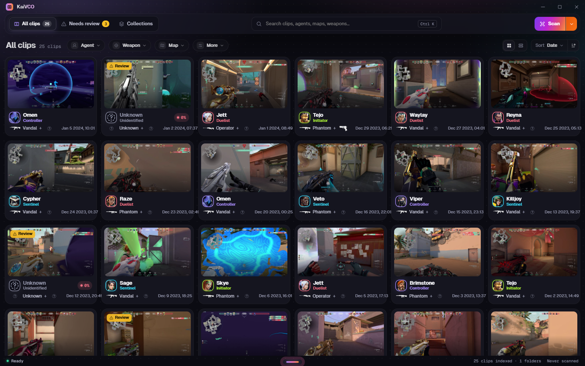
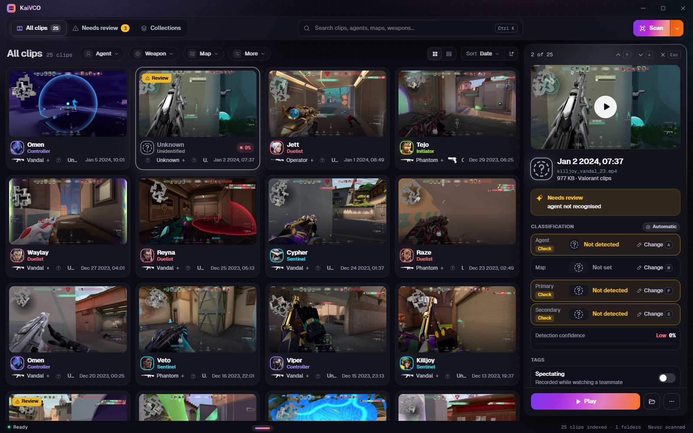

# KaiVCO

**A clip organizer for VALORANT.** KaiVCO reads the in-game HUD of each saved clip to work out who you played and what you used, so you can find any moment without renaming a single file.

[**⬇ Download KaiVCO 1.0.0 for Windows**](https://github.com/KaiZ-Dev33/KaiVCO-releases/releases/latest) · [Website](https://kaizeryo.pages.dev/kaivco/) · [Discord](https://discord.gg/zz98Bk8xjQ)

## What it does

- **Scans your clip folders** and builds a searchable library from the videos you already have.
- **Detects the agent, weapon and map** for each clip, and lets you correct anything it gets wrong, with undo.
- **Filters and tags** so any moment is a click away. Bulk edit handles many clips at once.
- **Stays on your PC.** The library, thumbnails and settings are stored locally. Removing a clip from the library never deletes the video file.

More screens are on the [features page](https://kaizeryo.pages.dev/kaivco/features/).

## Install

1. Download `KaiVCO-Setup-1.0.0.0.exe` from the [latest release](https://github.com/KaiZ-Dev33/KaiVCO-releases/releases/latest).
2. Run it. It installs for your user only, so no admin rights are needed. If WebView2 is missing, the installer sets it up.
3. Open KaiVCO and add your clip folder.

**Requirements:** Windows 10 or 11 (64-bit), about 300 MB of disk space.

The installer is signed by *Kaizeryo Software*.

## Support and feedback

Questions, bug reports and ideas are welcome on the [Kaizeryo Discord](https://discord.gg/zz98Bk8xjQ).

## About

KaiVCO is free software by Kaizeryo Software and is closed-source. This repository only hosts releases.

VALORANT and its agent, weapon and map artwork are trademarks of Riot Games, Inc. KaiVCO is an independent tool and is not endorsed by or affiliated with Riot Games.
